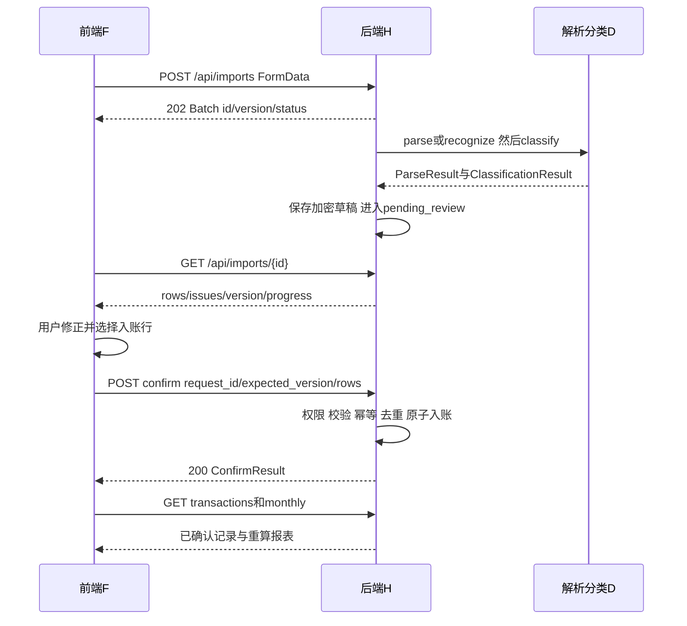

# 页面与后端接口对接说明

契约版本 0.2.0。F 按本说明组织页面，H 按11实现HTTP，D按13提供内部模块。浏览器端统一调用 contracts/client.generated.ts 的导出函数；不得各页面自行发明路径、字段或结果包装。

## 环境和调用入口

前端开发地址为 http://127.0.0.1:5173，后端为 http://127.0.0.1:8000。Vite代理 /api 和 /health 至后端，SDK baseUrl 为空字符串即可。Compose对外默认8080，浏览器仍同源调用。地址是T00需实现的开发约定，当前没有已启动服务。

复制生成SDK到 frontend/src/api/client.generated.ts，并由生成命令持续同步；或T00配置从contracts直接导入，三人共同选择一种。生成文件禁止手改。请求示例如下，文件名和字段与SDK一致：

```typescript
import { login, getImport, confirmImport, getMonthlyReport, patchTransaction, ApiError } from "./client.generated";

const session = await login({body:{username, password}});
const csrf = session.csrf_token; // 存在会话状态中，Cookie由浏览器保存
const batch = await getImport({path:{id: batchId}});
// 用户在界面完成修正；confirmedRows按ConfirmRow构建，不能原封不动提交缺失字段草稿
const result = await confirmImport({path:{id:batch.id},body:{
  request_id:crypto.randomUUID(), expected_version:batch.version, rows:confirmedRows
}}, csrf);
const report = await getMonthlyReport({query:{month:"2026-11"}});
try {
  await patchTransaction({path:{id:transaction.id},body:{
    expected_version:transaction.version, changes:{category:"dining"}, remember_rule:true
  }}, csrf);
} catch (error) {
  if (error instanceof ApiError && error.status === 409) {
    // 重新读取列表和当前版本，由用户核对后再保存，不自动覆盖
  }
}
```

以上片段中的username、batchId、confirmedRows、transaction由页面状态提供；示例不是独立可运行页面。SDK只封装类型与HTTP，不实现OCR、数据库或会话服务。

## 页面调用对照

| 页面和事件 | 准确SDK函数及HTTP | 输入来源 | 成功后页面行为 | 失败行为 |
| --- | --- | --- | --- | --- |
| 页面启动 | getSession，GET /api/auth/me | 浏览器Cookie | 保存user和csrf_token | 401跳登录 |
| 提交登录 | login，POST /api/auth/login | username、password | 保存Session，进入账单页 | AUTH_INVALID显示登录失败；429等待 |
| 点击退出 | logout，POST /api/auth/logout | 当前CSRF | 204后清理会话，不解析JSON | 会话已失效时仍清本地状态 |
| 上传文件或截图 | createImport，POST /api/imports | source、ingestion_method、File | 保存批次id，进入确认页 | 413/415/422显示文件问题 |
| 读取或轮询批次 | getImport，GET /api/imports/{id} | 创建返回id或路由id | 用status、version、rows、progress更新，不提前计入报表 | failed显示issues和重试；401/404停止 |
| 查看原图 | getImportOriginal，GET /api/imports/{id}/original | 当前批次id | Blob创建临时object URL，页面退出时revoke | 不把二进制当JSON；404或503提示 |
| 重试失败批次 | retryImport，POST /api/imports/{id}/retry | failed批次最新version | 202后保存新version，再轮询 | 409刷新批次，不强行重试已完成任务 |
| 确认入账 | confirmImport，POST /api/imports/{id}/confirm | 草稿row_id、用户修正字段、版本、request_id | 显示created/duplicate/ignored数量，刷新列表及当前月报 | 字段错定位行；冲突按code处理 |
| 账单筛选和翻页 | listTransactions，GET /api/transactions | date_from/date_to/category/source/flow_type/page/page_size | 展示items和total，不自行增减汇总数字 | 422修筛选；空结果不是错误 |
| 编辑及记住分类 | patchTransaction，PATCH /api/transactions/{id} | 列表中的id和version，changes，remember_rule | 更新交易，再刷新列表、月报和规则页 | 409保留输入并刷新；422字段提示 |
| 查询规则 | listRules，GET /api/classification-rules | Cookie | 显示enabled与商户、类别、版本 | 401回登录 |
| 停用或修改规则 | patchRule，PATCH /api/classification-rules/{id} | 规则id、version及enabled/category | 更新该规则，不宣称重写历史 | 409刷新规则；不能影响其他用户 |
| 月报切换 | getMonthlyReport，GET /api/reports/monthly | 显式month | totals、毛支出饼图、全月daily_trend、budgets | 无数据按0显示，不虚构环比 |
| 保存预算 | putBudget，PUT /api/budgets | month、category、amount_fen | 200后重新读取本月月报 | 非法类别或金额显示422 |
| 导出明细 | exportTransactions，GET /api/exports/transactions.csv | 账单页同一筛选对象，去掉page/page_size | 下载Blob，导出全部筛选结果 | 不按JSON解析；错误JSON读ApiError |
| 导出月报 | exportMonthlyPdf，GET /api/exports/monthly.pdf | 页面正在查看的month | 下载PDF并可实际打开检查 | 503保留页面、允许手动重试 |

## 入账顺序与状态



处理中的状态是uploaded或processing；pending_review才可确认；completed显示已处理结果并关闭确认按钮；failed显示原因。轮询首次1秒、后续2秒，120秒未完成暂停自动轮询并提示可手动刷新。服务端批次总期限300秒，超时转failed并写BATCH_TIMEOUT；模型失败可回退pending类别而非使所有可识别账单丢失。

确认点击后生成一次request_id，保存“请求ID及其序列化请求体”。网络断开时重试同一快照；用户修改内容后换ID。服务端先识别已成功的幂等重放，再检查expected_version，保证成功响应丢失后重试仍返回原结果。明确重复不新增；疑似重复需要用户对该行显式确认；未选行计ignored_count。所有行验证通过才提交。

## 修正到新规则的对接

1. F提交patchTransaction，明确changes.category及remember_rule=true。
2. H读取并锁定本人交易，校验版本，在同一事务更新账单、加密索引、日志和规则。
3. 用户规则匹配键为本人、source、标准化merchant。H在下一次批次处理时仅把本人的规则传给D。
4. D按row_id返回category和user_rule来源，H保存到新草稿，F可见该依据。
5. 用户确认另一笔新交易后，月报才加入新记录；停用规则不修改已确认历史。

## 两端联调的通过条件

H不能返回HTTP 200包着error，F不能接受任意成功状态码。写请求CSRF、字段名、状态码、可空含义都必须一致。前端使用SDK做类型检查；后端用共享请求响应模型；实际HTTP返回再按契约Schema验证。Postman模板不是一键完整业务回放，详见15。
